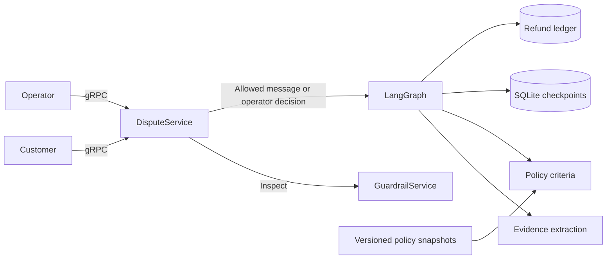
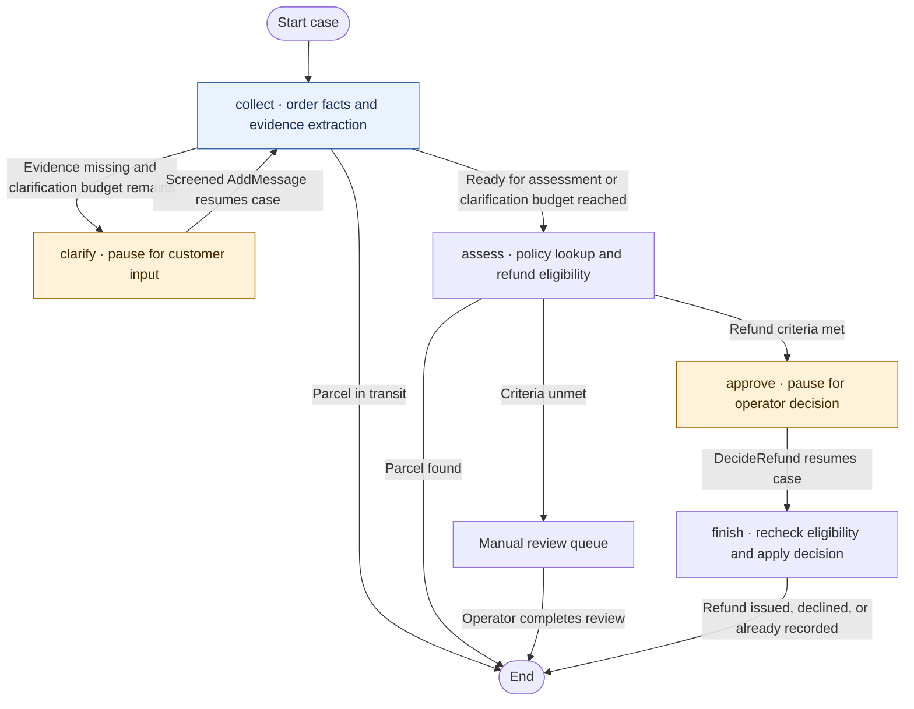

# Marketplace Delivery Disputes

An agent-assisted workflow for marketplace support teams handling missing parcels. It collects order facts, asks customers for missing details, applies versioned business rules, and routes eligible cases to an operator for a refund decision. Both service boundaries use gRPC over HTTP/2. The local demo uses synthetic orders, a persistent refund simulator, and selectable mock or Amazon Bedrock model adapters.



## Agent workflow

The diagram follows the five nodes in [`build_graph`](resolveflow/workflow.py). Edge labels show the conditions that route a case or the gRPC call that resumes it.



| Framework | What the workflow demonstrates |
| --- | --- |
| LangGraph | A typed state schema, conditional routing, a bounded clarification loop, and two `interrupt()` points. SQLite checkpoints persist the case by `thread_id`, and the gRPC handlers resume it with `Command(resume=...)`. |
| LangChain | One model-backed step uses `ChatBedrockConverse.with_structured_output()` to extract customer-reported facts and their supporting quotes. The graph applies eligibility criteria deterministically. |

The graph checks refund eligibility in code and requires an authenticated operator decision. The final node applies that decision through the idempotent ledger.

## Quick start

### Docker Compose

Use the existing local `.env` if present. On a fresh checkout, copy `.env.example` to `.env` and generate distinct customer and operator tokens. Generate each value with `python -c 'from secrets import token_urlsafe; print(token_urlsafe(32))'`. The default `MODEL_PROVIDER=mock` uses no cloud credentials.

From the project directory, build and start both gRPC services, run the demo and tests, then try a small load run.

```bash
docker compose up --build --wait
docker compose exec api python -m resolveflow.demo
docker compose exec api python -m unittest discover -v
docker compose exec api python -m resolveflow.load_test --requests 200 --concurrency 32
docker compose logs -f api guardrail
```

`docker compose down` stops the services and preserves the SQLite volume. The API is published on `127.0.0.1:50052`. Compose leaves the guardrail port inside the container network. Both containers expose gRPC health checks, and the API starts after the guardrail is healthy. `.env` is passed to the API container at runtime and excluded from image builds. The local Compose configuration runs one API instance. [Docker Compose startup order](https://docs.docker.com/compose/how-tos/startup-order/)

### Python without Docker

Use Python 3.12. Generate Python stubs from both Protobuf contracts.

```bash
python3.12 -m venv .venv
source .venv/bin/activate
python -m pip install -r requirements.txt
python -m grpc_tools.protoc -I . --python_out=. --grpc_python_out=. resolveflow/proto/guardrails.proto resolveflow/proto/disputes.proto
```

Run the services in two terminals and the demo in a third, from the repo directory.

```bash
.venv/bin/python -m resolveflow.mock_guardrail
```

```bash
.venv/bin/python -m resolveflow.server
```

```bash
.venv/bin/python -m resolveflow.demo
```

The first run asks for clarification, blocks a synthetic prompt-injection marker, accepts the clean answer, waits for operator approval, issues a simulated refund, and repeats the approval. A later run produces `REFUND_ALREADY_ISSUED` for the same synthetic order. To start a fresh demo, use a different `DATA_DIR` and restart the dispute service.

## Project layout and storage

| Path | Responsibility |
| --- | --- |
| `resolveflow/proto/` | Protobuf contracts for disputes and input screening |
| `resolveflow/server.py`, `resolveflow/service.py` | Service startup, RPC handlers, authorization, and request validation |
| `resolveflow/workflow.py`, `resolveflow/agents.py` | Dispute graph, model adapters, and structured outputs |
| `resolveflow/guardrails.py`, `resolveflow/mock_guardrail.py` | Guardrail client and local screening service |
| `resolveflow/orders.py` | Synthetic orders and idempotent refund ledger |
| `policies/`, `evals/`, `tests/` | Versioned rules, golden cases, and automated checks |

The local demo uses SQLite without a separate database server. `resolveflow.server` creates `checkpoints.sqlite` and `refunds.sqlite` under `DATA_DIR` (`.data/` by default). The first file keeps LangGraph state across restarts. The second records simulated refunds and enforces uniqueness per order. The policy archive stores executable criteria and associated rule text in JSON.

The AWS design uses one shared PostgreSQL instance on RDS for checkpoints and refunds. Multiple API or worker replicas would also need database-backed coordination per case. See the deployment design below. [LangGraph persistence](https://docs.langchain.com/oss/python/langgraph/persistence)

## gRPC contracts and failure behavior

| RPC | Role | Behavior |
| --- | --- | --- |
| `OpenCase` | Customer | Screens the initial message and pins the active policy version and hash. An identical replay resumes pending work and returns the current state. |
| `AddMessage` | Customer | Requires the active `clarification_id` from the case response. Screens new text before recording it. An exact replay resumes pending work, while a stale answer with a new message ID returns `FAILED_PRECONDITION`. |
| `GetCase` | Customer or operator | Reads the current stage, reply, policy version and hash, and citations. |
| `ListReviews` | Operator | Lists pending refund decisions and manual reviews with supporting quotes, order status, required facts, and routing reason. |
| `CompleteReview` | Operator | Resolves a manual review with a customer-visible reply. |
| `DecideRefund` | Operator | Records explicit approval or rejection. Repeating the decision resumes pending work and returns the current state. |
| `RetryCase` | Operator | Restarts a pending graph step after a dependency error. Cases waiting for human input keep their current stage. |
| `Inspect` | Internal | Returns an allow or block verdict with the guardrail version and reason codes. |

The [dispute contract](resolveflow/proto/disputes.proto) and [guardrail contract](resolveflow/proto/guardrails.proto) are versioned independently. Send demo credentials as `authorization: Bearer <token>`. Both services expose standard gRPC health checking. Direct Python runs bind to loopback by default.

Input checks run before text reaches LangGraph or its checkpoint database. Explicit blocks map to `PERMISSION_DENIED`. Guardrail timeouts, outages, and invalid verdicts map to `UNAVAILABLE`. Invalid input maps to `INVALID_ARGUMENT`. The gRPC concurrency cap returns `RESOURCE_EXHAUSTED` under saturation. The API logs outcome, latency, request ID, and error codes without user text, credentials, or raw exception messages. [gRPC deadlines](https://grpc.io/docs/guides/deadlines/)

A customer command is accepted when its screened input and identifier reach the checkpoint. Repeating the accepted command resumes processing without recording it again. The service makes one recovery pass at startup. If the dependency remains unavailable, the caller can retry the same command or an operator can call `RetryCase`. Synchronous graph checkpoints persist the approval step before refund execution. After a crash following the ledger commit, rerunning the step reads the same refund ID. A unique SQLite constraint allows one refund per order. [LangGraph persistence](https://docs.langchain.com/oss/python/langgraph/persistence)

Pending review tasks are represented by the persisted state of each case. The operator queue reads that state, and a manual review can be closed through the API. The demo reports queue status without promising a response time.

## Policy changes and evaluation

`refund_criteria` defines allowed order statuses, whether the order must be refundable, and which customer facts must be true. New policy revisions get new IDs and a SHA-256 of canonical JSON in `policies/manifest.json`. Preserve the published snapshots and their manifest entries when releasing a revision. The service validates the archive and checks hashes pinned in existing cases at startup. Checkpoints written before hashes were introduced resolve their version against the bundled legacy archive. `v3` removes the requirement to contact the carrier. The default active version remains `v2`.

```bash
.venv/bin/python -m resolveflow.policy_diff policies/v2.json policies/v3.json
.venv/bin/python -m unittest discover -v
.venv/bin/python -m resolveflow.evaluate --provider mock --policy v2
.venv/bin/python -m resolveflow.evaluate --provider bedrock --policy v2
```

The golden cases check gRPC routing with the mock. The separate synthetic labelled set measures fact accuracy, positive precision and recall, quote support, incorrect referrals for a refund, extra clarifications and manual reviews, invalid output, and extraction latency. The report records the model and policy and prompt hashes for comparison. Bedrock evaluation uses the configured model and sends only the synthetic fixtures. The small set supports regression checks and targeted error analysis.

## AWS Bedrock

Set `MODEL_PROVIDER=bedrock`, `AWS_REGION`, and `BEDROCK_MODEL_ID` in `.env`. Choose a Converse model or inference profile with tool calling and structured output support in your account. Configure an AWS profile, temporary credentials, or `AWS_BEARER_TOKEN_BEDROCK`. The code uses `ChatBedrockConverse` with typed evidence, bounded SDK timeouts, and at most one application retry for transient errors. IAM and authentication errors surface without an automatic retry. [LangChain Bedrock integration](https://docs.langchain.com/oss/python/integrations/chat/bedrock) · [Bedrock API keys](https://docs.aws.amazon.com/bedrock/latest/userguide/api-keys-use.html)

## Load behavior and AWS deployment design

The local services reuse gRPC channels across calls, reject excess concurrent RPCs, bound message size and clarification count, and serialize updates within a case. The in-transit scenario measures guardrail, graph and persistence. The delivered scenario also opens a missing parcel dispute, answers one clarification and measures the path to an operator decision.

```bash
.venv/bin/python -m resolveflow.load_test --requests 200 --concurrency 32
.venv/bin/python -m resolveflow.load_test --scenario delivered --requests 50 --concurrency 8
```

The report includes successful requests per second, p50/p95/p99 latency for successful calls, and counts by status. Use a separate `DATA_DIR` for load runs because accepted requests create cases.

| Concern | AWS target design |
| --- | --- |
| Independent scaling | Run ingress, guardrail, and model workers as separate ECS Fargate services with TLS and workload authentication. Add per-tenant quotas and cap aggregate model concurrency against Bedrock request and token quotas. |
| Backpressure | A gRPC command returns a queued case after screening and a transactional outbox commit. SQS buffers worker load. Scale on queue age and backlog per worker. |
| Checkpointing and replay | Move checkpoints and ledger to Postgres with per-case concurrency control across replicas. Acknowledge queue items after durable processing. Deduplicate by command ID and route repeated failures to a DLQ. [SQS delivery semantics](https://docs.aws.amazon.com/AWSSimpleQueueService/latest/SQSDeveloperGuide/standard-queues-at-least-once-delivery.html) |
| Operations | Export OTel traces and aggregate latency, provider throttling, guardrail error rate, queue age, refund deduplication, and cost per completed dispute into CloudWatch or Grafana. Exercise overload, outages, and worker restarts in staging before publishing performance numbers. |

## Mocks and verification status

| Component | Status |
| --- | --- |
| Guardrail | **Mock.** Uses synthetic markers for prompt injection and banned-word verdicts. Replace with an evaluated classification service before processing real customer messages. |
| Model | **Mock by default.** Rule-based evidence extraction makes local demos reproducible. The Bedrock adapter is implemented and requires credentials and live validation. |
| Orders and refund | **Synthetic.** Read-only fixture orders and a SQLite refund ledger simulate the integration. No payments are initiated. |
| Identity and manual review | **Demo.** Two role tokens represent one customer and one operator. One operator role works from the SQLite-backed queue via gRPC. |
| Policy | **Local snapshots.** Tests cover policy archive validation and changes to eligibility. |
| AWS deployment | **Architecture only.** ECS, SQS, Postgres, deployment automation, and dashboards are unprovisioned. |
| Runtime verification | Local evidence, policy and ledger tests and the mock evaluation have been run. The gRPC fault-injection and restart scenarios are covered in CI. A live Bedrock evaluation requires credentials and model access. |
